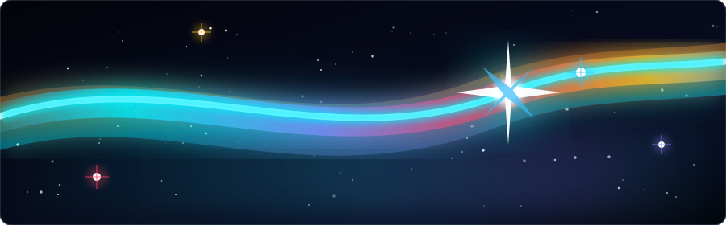
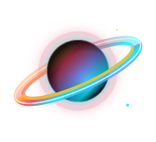

<!-- ==================== CINEMATIC COSMIC BANNER ==================== -->

  

<!-- ==================== MINIMALIST ACTION PILLS ==================== -->

&nbsp;

&nbsp;

&nbsp;

 

<!-- ==================== MAIN GLASSMORPHIC CARD (SPACIOUS VERTICAL FLOW) ==================== -->
<table width="100%">
<tr>
<td style="background-color: #060914; border: 1.2px solid #1e293b; border-radius: 14px; padding: 28px;">

<h3 style="color: #f8fafc; margin-top: 0; font-family: monospace; font-size: 18px;">› Hey there! I'm Limbot3 👋</h3>

<h4 style="color: #38bdf8; margin-top: 6px; font-size: 16px;">Fullstack Engineer &amp; Systems Architect</h4>

I am based in <b>Indonesia</b> and deeply passionate about crafting minimalist, high-performance web applications and building efficient automated workflows.

Currently, I'm focusing my energy on building scalable cloud services, type-safe fullstack platforms, and modular distributed systems. My technical playground revolves around <b>React, TypeScript, Go, Python, Docker,</b> and orchestrating automated pipelines to deliver reliable software.

 

  

</td>
</tr>
</table>

 

<!-- ==================== SAAS TECH CARDS: FOCUS & CAPABILITIES ==================== -->
<table width="100%">
<tr>
<td width="33%" valign="top" style="background-color: #060914; border: 1px solid #1e293b; border-radius: 12px; padding: 18px;">
<h4 style="color: #38bdf8; margin-top: 0;">⚡ Frontend &amp; Mobile</h4>

Crafting type-safe, responsive, and fluid interfaces with React, Next.js, Tailwind, and Flutter.

</td>
<td width="33%" valign="top" style="background-color: #060914; border: 1px solid #1e293b; border-radius: 12px; padding: 18px;">
<h4 style="color: #818cf8; margin-top: 0;">⚙️ Distributed Backends</h4>

Designing resilient REST &amp; gRPC APIs, concurrent microservices, and databases with Go &amp; Python.

</td>
<td width="33%" valign="top" style="background-color: #060914; border: 1px solid #1e293b; border-radius: 12px; padding: 18px;">
<h4 style="color: #f43f5e; margin-top: 0;">☁️ Cloud &amp; DevOps</h4>

Automating infrastructure and continuous delivery pipelines with Docker, Kubernetes, and Linux.

</td>
</tr>
</table>

 

<!-- ==================== LANGUAGES & TOOLS ==================== -->

<h3 style="font-family: monospace;">★.ᐟ Languages &amp; Tools:</h3>

 

<!-- ==================== GITHUB ANALYTICS ==================== -->

<h3 style="font-family: monospace;">★.ᐟ GitHub Velocity &amp; Stats:</h3>

<table width="100%" border="0">
<tr>
<td width="50%" align="center" style="border: none;">

</td>
<td width="50%" align="center" style="border: none;">

</td>
</tr>
</table>
 

 

<!-- ==================== CONTRIBUTIONS ==================== -->

<h3 style="font-family: monospace;">★.ᐟ Contributions Activity:</h3>

<picture>
<source media="(prefers-color-scheme: dark)" srcset="https://raw.githubusercontent.com/Limbot3/Limbot3/output/github-contribution-grid-snake-dark.svg">
<source media="(prefers-color-scheme: light)" srcset="https://raw.githubusercontent.com/Limbot3/Limbot3/output/github-contribution-grid-snake.svg">

</picture>

