  <!-- Header Banner Wave -->
  

  <!-- Native Animated Terminal Typing (Self-Hosted, 100% Working) -->
  

    

  <!-- Quick Social & Status Badges -->
  
  
  

 

<!-- ==================== BENTO SECTION 1: ABOUT & SPOTIFY ==================== -->
<table>
  <tr>
    <td width="60%" valign="top">
      <h3>🚀 Engineering Overview</h3>
      <ul>
        <li>💻 <b>Multidisciplinary Engineer:</b> Bridging <b>Frontend, Backend, Mobile, Data/AI</b>, dan <b>DevOps</b>.</li>
        <li>🎯 <b>Fokus:</b> High-performance scalable architectures, seamless UI/UX, dan AI automation workflows.</li>
        <li>⚡ <b>Prinsip:</b> <i>Clean Architecture &bull; Automation First &bull; Continuous Delivery.</i></li>
        <li>📫 Kontak langsung: <a href="mailto:limwawin3@gmail.com"><b>limwawin3@gmail.com</b></a>.</li>
      </ul>
    </td>
    <td width="40%" align="center" valign="top">
      <h3>🎧 Live Audio Stream</h3>
      
      
<i>Deep Work &bull; Lo-Fi Beats &bull; Espresso ☕</i>

    </td>
  </tr>
</table>

<!-- ==================== BENTO SECTION 2: TECH STACK MATRIX ==================== -->
 

  <h2>🛠️ Modern Tech Stack &amp; Tools</h2>

<table>
  <tr>
    <td width="50%">
      <b>🎨 Frontend &amp; Mobile Ecosystem</b>  
      
    </td>
    <td width="50%">
      <b>⚙️ Backend &amp; Cloud Database</b>  
      
    </td>
  </tr>
  <tr>
    <td width="50%">
      <b>🧠 Data Science &amp; Artificial Intelligence</b>  
      
    </td>
    <td width="50%">
      <b>☁️ DevOps, Cloud &amp; Infrastructure</b>  
      
    </td>
  </tr>
</table>

<!-- ==================== BENTO SECTION 3: KOTAK-KOTAK HIJAU MONTH (ANIMATED) ==================== -->
 

  <h2>📅 Interactive Contribution Activity Flow</h2>
  
<i>Animasi gelombang kontribusi bulanan (Jan - Dec) dengan efek radar scanner</i>

  
  

 

<!-- ==================== BENTO SECTION 4: SNAKE GAME (AUTONOMOUS RUNNER) ==================== -->

  <h2>🐍 Snake Game Contribution Activity</h2>
  
<i>Ular otonom memakan riwayat komit dengan neon glowing trail</i>

  

 

<!-- ==================== BENTO SECTION 5: GITHUB METRICS & ANALYTICS ==================== -->

  <h2>📊 GitHub Productivity &amp; Velocity</h2>

<table>
  <tr>
    <td width="50%" align="center" valign="middle">
      
    </td>
    <td width="50%" align="center" valign="middle">
      
    </td>
  </tr>
  <tr>
    <td colspan="2" align="center">
      
    </td>
  </tr>
</table>

 

<!-- Footer Wave Banner -->

  

